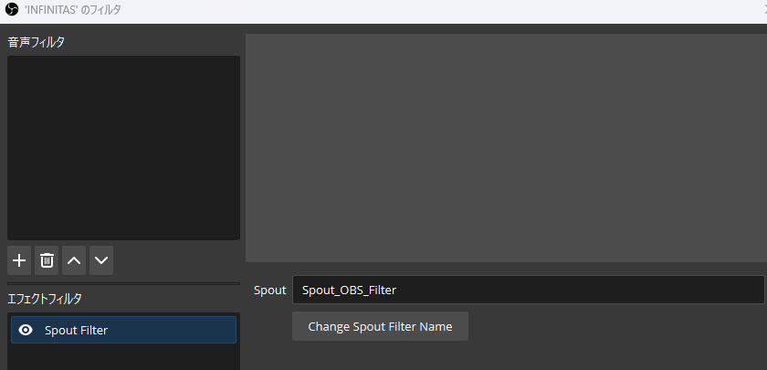
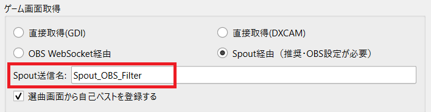

# ゲーム画面の取得

打鍵カウンタは、ゲーム用PCのINFINITAS映像を読み取って打鍵数やリザルトを記録します。
「ファイル」→「基本設定」→「基本設定」タブの「ゲーム画面取得」で方法を選びます。
最初は設定の少ない **直接取得(GDI)** で動作を確認できます。

## 直接取得(GDI・DXCAM)

初期値は **直接取得(GDI)** です。OBSの起動や接続設定は不要です。
INFINITASを起動してゲーム画面を表示し、メイン画面の取得状態と現在のモードを確認します。
取得できない場合は、ゲーム画面が他のウィンドウで隠れていないか確認してください。

GDIで複数モニターからの取得に問題がある場合は、「自動判定せずに常に全モニターを対象にする」を試せます。
別方式の **直接取得(DXCAM)** へ切り替えて比較することもできます。

## Spout経由で取得する {#spout}

OBSに取り込んだゲーム映像を、Spout2プラグイン経由で打鍵カウンタへ渡します。
Wikiでは、直接取得より負荷を抑えるための方法として推奨しています。
RANDOMレーン認識を使う場合もSpout経由を選びます。

1. OBSをインストールし、[obs-spout2-pluginのReleaseページ](https://github.com/Off-World-Live/obs-spout2-plugin/releases)からWindows用インストーラーを取得してインストールします。
2. OBSを再起動し、INFINITASのゲーム映像を表示するゲームキャプチャソースを用意します。
3. ゲームキャプチャソースの「フィルタ」を開き、「エフェクトフィルタ」に **Spout Filter** を追加します。
4. フィルタに表示されるSpout送信名を確認します。
5. 打鍵カウンタの「ゲーム画面取得」で **Spout経由** を選び、「Spout送信名」に同じ文字列を入力します。
6. 「OK」で適用し、取得状態と現在のモードがゲーム映像に追従することを確認します。

打鍵カウンタ側の送信名の初期値は `Spout_OBS_Filter` です。OBS側で別の名前を使う場合は合わせてください。
配置認識には **1920×1080のゲーム映像** を使います。装飾や配信レイアウト全体ではなく、ゲーム映像そのものを送信してください。
OBSは起動したままにします。Spoutで画面を取得するだけなら、OBS WebSocketの接続設定や監視対象ソースの指定は不要です。

## OBS WebSocket経由で取得する

1. [OBSとの接続](obs-control.md#obs-connection)で、サーバー・ポート・パスワードを設定します。
2. [監視対象ソース](obs-control.md#monitor-source)に、ゲームキャプチャのシーンとソースを登録します。
3. 「ゲーム画面取得」を **OBS WebSocket経由** に切り替えます。
4. メイン画面の接続状態とゲーム画面取得状態を確認します。

直接取得・Spoutで取得する場合でも、OBSのシーンやソースを自動操作するには[OBS自動制御](obs-control.md)の接続が別途必要です。

## 取得できない場合

| 状態 | 確認すること |
| --- | --- |
| 直接取得で映像を読めない | ゲームが起動中か、画面が隠れていないか。GDI・DXCAMの切り替えや全モニター設定も確認 |
| Spoutの送信元を見つけられない | OBSが起動中か、ゲームソースにSpout Filterが付いているか、送信名が一致しているか |
| OBS WebSocketが接続できない | OBS側のサーバー有効設定と、両側のポート・パスワード・連携のON/OFF |
| OBS接続済みでも画像を取得できない | 監視対象のシーン・ソースが、現在のシーンコレクションに存在するか |
| 画面取得はできるが打鍵数を数えない | INFINITASのプレー設定（Start → E2）で「判定の数リアルタイム表示」が有効か |

画像の認識は1920×1080を基準にしています。大きさや表示内容を確認し、[導入手順](install.md)の1曲プレーまで確認してください。
