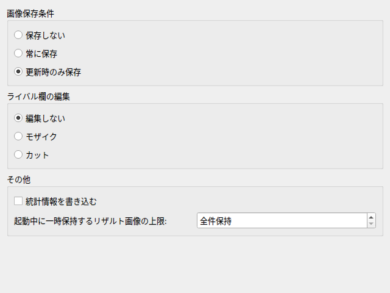

# リザルト画像の保存を設定する

「ファイル」→「基本設定」→「画像保存」を開きます。
設定を変更したら「OK」で適用します。「キャンセル」では変更を適用しません。

画像は説明書用に初期値で撮影したものです。OSやフォントによって見た目は異なります。

## 自動保存するタイミング

「画像保存条件」で、リザルト画像をファイルとして自動保存する条件を選びます。

| 項目 | 動作 |
| --- | --- |
| 保存しない | 自動保存しません。手動保存や、起動中の一時保持は利用できます。 |
| 常に保存 | 認識したリザルトを毎回保存します。 |
| 更新時のみ保存 | スコア・クリアランプ・BPのいずれかを更新した場合に保存します。自己ベストが未登録の場合も保存します。 |

新規設定での初期値は「更新時のみ保存」です。以前の設定を引き継いだ場合は異なることがあります。
保存先は「画像保存」タブではなく、「機能設定」タブの「画像保存先」で指定します。
手動で保存する場合は「ファイル」→「画像保存」を使います。

## ライバル欄の表示を加工する

「ライバル欄の編集」で、リザルト画像の加工方法を選びます。

| 項目 | 動作 |
| --- | --- |
| 編集しない | 加工しません。初期値です。 |
| モザイク | ライバル欄などのライバル名をモザイク処理します。 |
| カット | ライバル欄を切り取り、その他のライバル名をモザイク処理します。 |

「統計情報を書き込む」を有効にすると、リザルト画像にスコアなどの統計情報を追加します。初期値は無効です。
これらの加工は、一時保持するリザルト画像にも適用されます。
設定を変えても、すでに保存・一時保持された画像は作り直されません。

## 保存していない画像を起動中だけ使う

HTTPサーバの「RESULT IMAGES」やプレー履歴では、自動保存の対象にならなかったリザルトも投稿用画像に選べます。
このために、起動中に取得したリザルト画像を専用の一時フォルダに保持します。
通常の画像保存先に保存するファイルとは別です。

「起動中に一時保持するリザルト画像の上限」で保持枚数を設定します。

| 設定値 | 動作 |
| --- | --- |
| 0（全件保持） | 起動中に取得した全画像を保持します。初期値です。 |
| 1〜10000 | 指定した枚数を超えた古い一時画像から削除します。例えば100なら直近100枚です。 |

上限の変更は「OK」で適用した時点で反映されます。削除された一時画像は復元できません。
ファイルとして保存済みの画像は、この上限によって削除されません。

一時画像はディスク容量を使います。正常終了時に削除され、再起動後は利用できません。
残しておきたい画像はファイルとして保存してください。
