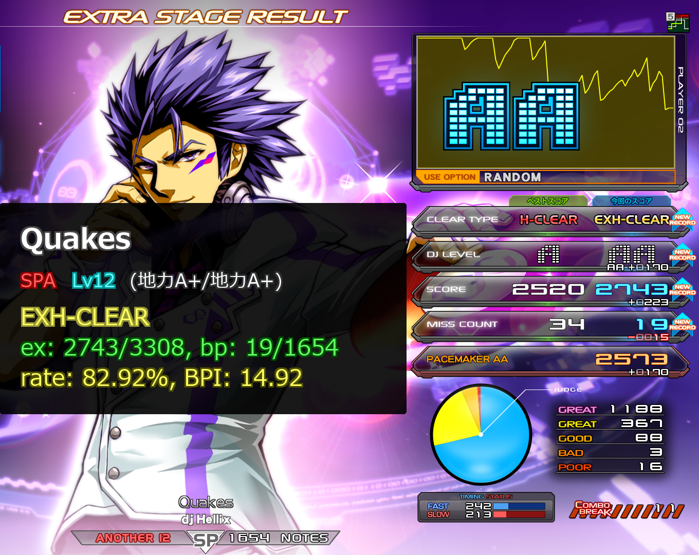

# リザルト画像の保存

認識したリザルトを自動で保存できます。初期設定では、**スコア・クリアランプ・BPのいずれかを更新したとき**に保存します。
自己ベストが未登録の曲も保存対象です。
保存先の初期値は、アプリのフォルダ内の `results` です。

## 保存するタイミングを変える

「ファイル」→「基本設定」→「画像保存」の「画像保存条件」で選びます。

- **更新時のみ保存**：更新したリザルトだけ残す。
- **常に保存**：認識したリザルトを毎回残す。
- **保存しない**：自動保存を止める。

その場の画面を手動で保存したいときは、メイン画面の「画像保存」または **F6** を使います。
保存先を変更する場合は、「基本設定」→「画像保存」の「画像保存先」でフォルダを指定します。

## 投稿用に見た目を整える

「画像保存」タブで、次の加工を選べます。

- **モザイク**：ライバル欄やライバル名を隠す。
- **カット**：ライバル欄を切り取り、その他のライバル名にモザイクをかける。
- **統計情報を書き込む**：曲名・スコア・BPIなどの情報を画像に追加する。

「カット」と「統計情報を書き込む」を組み合わせた保存例です。

設定後に取得するリザルトに適用されます。すでに保存した画像は変更されません。

## スマホから画像を選んで投稿する

[HTTPサーバ（スマホ連携）](mobile.md#result-images)では、自動保存しなかったリザルトも起動中だけ投稿用に使えます。
残しておきたい画像は、アプリを終了する前に保存してください。
