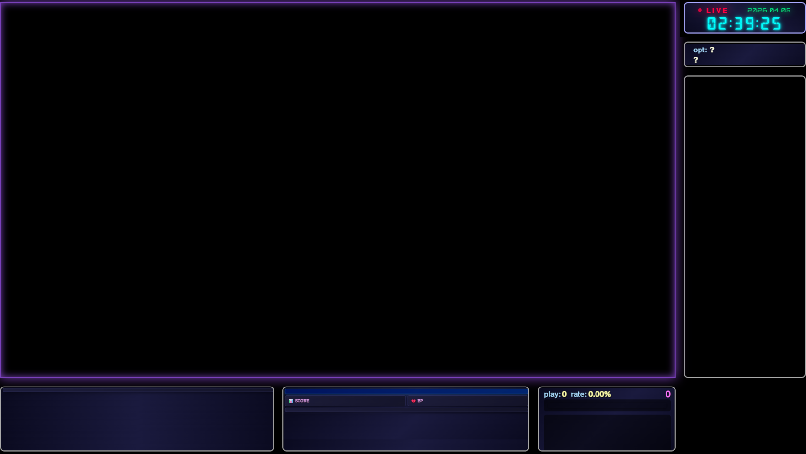
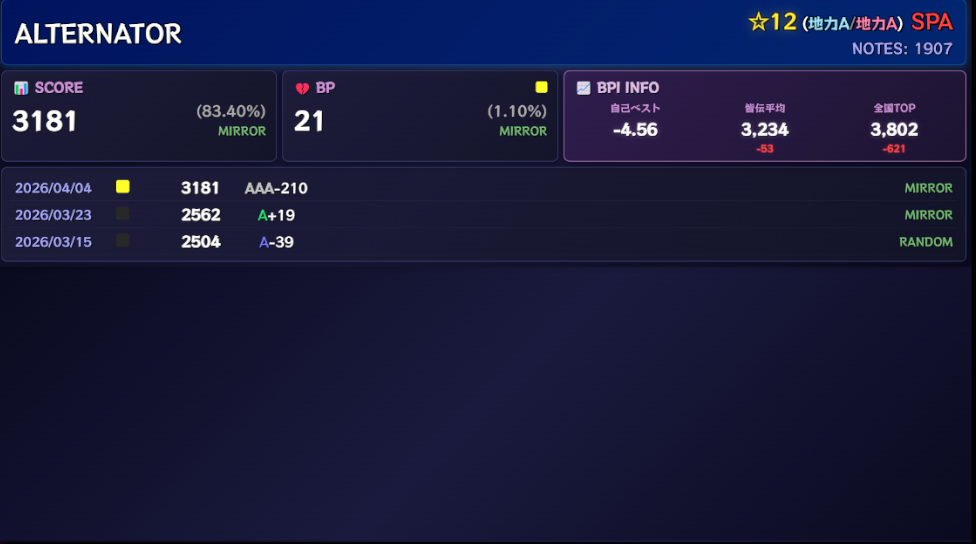
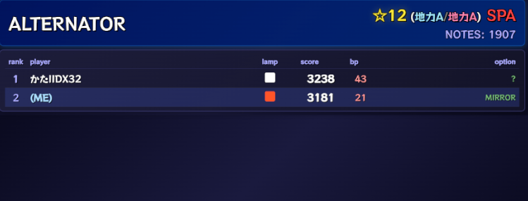
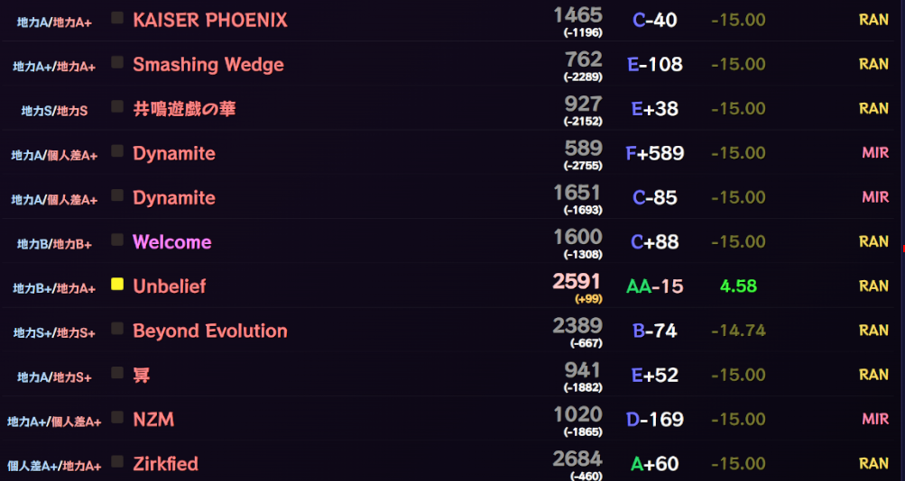
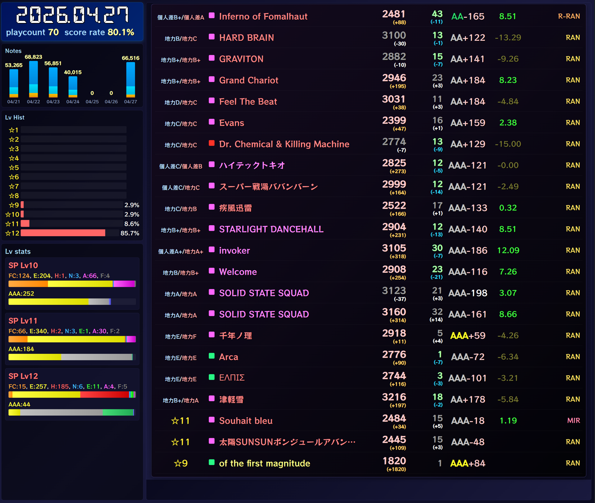
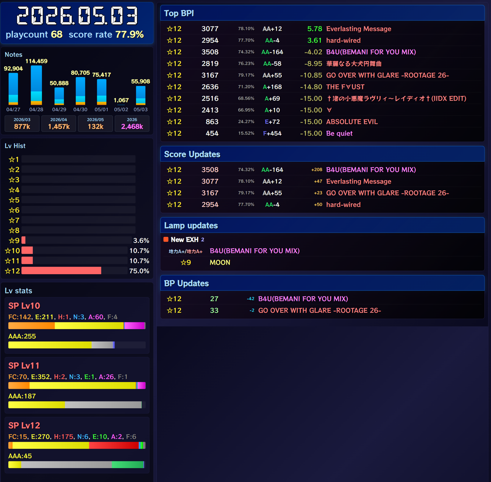
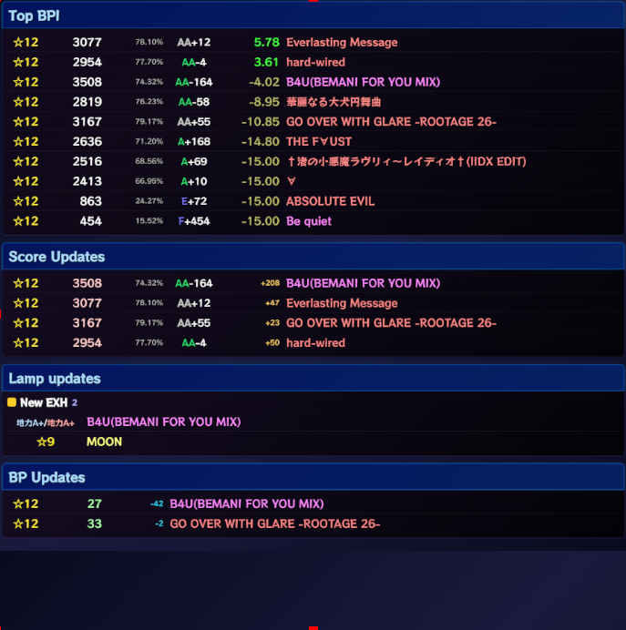
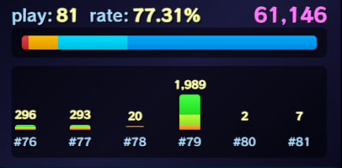
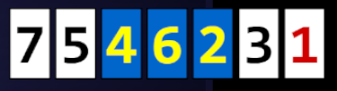

# OBS向けHTMLビューの利用方法

打鍵カウンタに同梱されたHTMLで、本日のプレーログ、単曲の履歴、ノーツ数などを表示できます。
Chromeなどのブラウザで直接開くことも、OBSの「ブラウザ」ソースとして配信・録画へ載せることもできます。
打鍵カウンタを起動したまま使ってください。

## OBSにビューを追加する

1. OBSの「ソース」の「＋」から「ブラウザ」を追加します。名前は分かりやすいもので構いません。
2. 「ローカルファイル」を有効にして、アプリの `template` フォルダにあるHTMLを選びます。
3. 下の一覧を参考に「幅」「高さ」を設定します。
4. パラメーターを変える場合は「カスタムCSS」に追記します。
5. ゲームをプレーし、ビューの内容が更新されることを確認します。

例えば、本日のプレーログなら `template/today_result.html` を選び、幅1920・高さ1080から調整します。
切れてしまう場合はブラウザソース自体の幅・高さを広げてから、OBS上で拡大縮小やトリミングをしてください。
Wikiの旧表記 `today_results.html` ではなく、現行のファイル名は **`today_result.html`** です。

カスタムCSSには、背景を透過させるための設定も残しておきます。

```css
body { background-color: rgba(0, 0, 0, 0.0); margin: 0px auto; overflow: hidden; }
```

主なHTMLビューは、打鍵カウンタの「データ表示用port」（初期値 **8767**）からデータを受け取ります。
**OBS WebSocketの接続設定は、ビューを表示するだけなら不要です。**
表示・非表示をゲーム画面に合わせて切り替える場合は、[OBS自動制御](obs-control.md)も設定します。
`random_lane.html` は例外で、同じフォルダに生成される配置情報ファイルを読みます。

## 使えるビュー

サイズは初めに試す目安です。文字数や配信レイアウトに合わせて調整してください。
表示例はWiki掲載時点のものです。設定名・初期値は現在のテンプレートに合わせています。

| ファイル（`template/` 内） | 内容 | 幅×高さの目安 |
| --- | --- | --- |
| [`whole_layout.html`](#whole-layout) | 配信画面風のレイアウト | 1920×1080 |
| [`history_cursong.html`](#history) | 現在の曲のプレー履歴 | レイアウトに合わせて調整 |
| [`rival.html`](#rival) | 現在の曲のライバル比較 | レイアウトに合わせて調整 |
| [`today_result.html`](#today-result) | 本日のプレーログ | 1920×1080 |
| [`today_stats.html`](#today-stats) | 打鍵数・レベル別の統計とプレーログ | 2600×2200 |
| [`today_receipt.html`](#receipt) | 本日の成果をレシート形式で表示 | 1500×1500 |
| [`graph.html`](#graph) | ノーツ数のグラフ | 500×250 |
| [`random_lane.html`](#random-lane) | SPのレーン配置 | 800×200 |
| `option.html` | 現在のオプション | レイアウトに合わせて調整 |
| `all_info.html` | 履歴・ライバル・グラフ・レシートの複合表示 | レイアウトに合わせて調整 |
| `column_log_cur_graph.html` | プレーログ・単曲履歴・グラフの横並び | レイアウトに合わせて調整 |

`mobile_score_viewer.html` は[スマホ連携](mobile.md)用です。ブラウザソースへの直接指定には使いません。

## 配信画面風ビュー {#whole-layout}

`whole_layout.html` は、時計・オプション・ライバル・履歴・グラフなどをまとめた1920×1080のビューです。
右側の空き枠は透過されるので、OBSでこのブラウザソースより下にゲーム映像などを置いて重ねられます。



```css
:root {
    --color-bg: #000;
    --enable-flash: 1;
    --flash-hh: 23;
    --flash-mm: 56;
}
body {
    --show-lane-numbers: 1;
}
```

`--color-bg` は背景色です。`--enable-flash: 1` で、時計が指定時刻に光る演出を有効にします（初期値は `0`）。
時・分は `--flash-hh` と `--flash-mm` に指定します。
`--show-lane-numbers: 1` は、埋め込んだ単曲履歴と本日結果にレーン番号を表示します。

## 単曲のプレーログ {#history}

`history_cursong.html` は、現在の曲の履歴を表示します。
表示サイズは配信レイアウトに合わせて調整してください。



レーン番号へ切り替える場合は、[共通のレーン番号設定](#lane-numbers)を指定します。
表示行数の初期値は `--max-rows: 20` です。

## ライバル欄ビュー {#rival}

`rival.html` は、[ライバル登録](rivals.md)したCSVと現在の曲を比較します。



曲名などのヘッダーを表示したい場合は、次を設定します。初期値は `0`（非表示）です。

```css
:root {
    --enable-header: 1;
}
```

## 本日のプレーログ {#today-result}

`today_result.html` は、本日の結果を一覧表示します。
幅1920・高さ1080を目安にし、必要な行数に合わせて高さを調整します。



```css
:root {
    --show-bp: 1;
    --show-best-delta: 1;
    --bpi-min: -15;
    --filter-mode: updates_only;
}
body {
    --show-lane-numbers: 1;
}
```

| 設定 | 意味・初期値 |
| --- | --- |
| `--show-bp` | `1` でミスカウントを表示。初期値 `0` |
| `--show-best-delta` | `1` で自己ベストとの差分を表示。初期値 `1` |
| `--bpi-min` | BPIで絞り込む場合の最低値。初期値 `-15` |
| `--filter-mode` | 表示対象。初期値 `all` |
| `--max-rows` | 表示行数。初期値 `27` |

`--filter-mode` は `all`（全件）、`updates_only`（更新した曲）、
`bpi_only`（指定BPI以上）、`updates_or_bpi`（更新または指定BPI以上）から選べます。
表示する過去ログの範囲は、アプリ側の[本日の成果に含めるオフセット](settings.md#additional)でも調整できます。

## 統計情報ビュー {#today-stats}

`today_stats.html` は、ノーツ数・レベル別統計と本日の結果をまとめて表示します。
幅2600・高さ2200が目安です。



以下は初期設定と同じ値の例です。

```css
:root {
    --notes-graph-days: 7;
    --show-bp: 1;
    --show-best-delta: 1;
    --filter-mode: all;
    --stats-levels: sp11,sp12;
    --lv-stats-position: left;
    --playlog-page: result;
    --receipt-top-bpi-count: 10;
    --receipt-sections: bpi,rank,score,lamp,bp;
    --receipt-hide-zero-pre-score: 1;
    --monthly-notes-count: 3;
    --period-notes-unit: k;
    --monthly-notes-label-color: #aaddff;
    --monthly-notes-value-color: #ffbb77;
    --yearly-notes-label-color: #aaddff;
    --yearly-notes-value-color: #ff77ff;
}
```

| 設定 | 用途 |
| --- | --- |
| `--notes-graph-days` | ノーツ数グラフに表示する日数 |
| `--show-bp` / `--show-best-delta` | BP・自己ベストとの差分の表示 |
| `--filter-mode` | 右側のプレーログの絞り込み。値は[本日のプレーログ](#today-result)と共通 |
| `--stats-levels` | レベル別統計の対象。`sp11,dp10` のようにカンマ区切り |
| `--lv-stats-position` | レベル別統計の位置。`left` または `bottom` |
| `--playlog-page` | 右側を `result`（プレーログ）または `receipt`（成果レシート）にする |
| `--receipt-top-bpi-count` | レシートのTop BPI曲数 |
| `--receipt-sections` | レシートの表示項目と順序 |
| `--receipt-hide-zero-pre-score` | `1` で、それまでのスコアが0だった曲をスコア更新欄から除外 |
| `--monthly-notes-count` | 月間ノーツ数を何か月分表示するか |
| `--period-notes-unit` | `raw` はノーツ数をそのまま、`k` はキロ単位で表示 |
| `--monthly-notes-label-color` / `--monthly-notes-value-color` | 月間ノーツ数のラベル色・数字色 |
| `--yearly-notes-label-color` / `--yearly-notes-value-color` | 年間ノーツ数のラベル色・数字色 |

`--playlog-page: receipt` に変えると、右側を成果レシートにできます。
この場合は幅2000・高さ2200も目安になります。



## 本日の成果レシート {#receipt}

`today_receipt.html` は、本日の更新などをレシート形式で表示します。
幅1500・高さ1500を目安に、項目数に合わせて調整します。



```css
:root {
    --top-bpi-count: 10;
    --sections: bpi,rank,score,lamp,bp;
    --hide-zero-pre-score: 1;
}
```

`--top-bpi-count` はTop BPIの曲数、`--sections` は表示項目と順序です。
`bpi`・`rank`・`score`・`lamp`・`bp` から必要なものをカンマ区切りで指定します。
`--hide-zero-pre-score: 1` は、それまでのスコアが0だった曲をスコア更新欄から除きます。

## ノーツ数グラフ {#graph}

`graph.html` はノーツ数の推移を表示します。幅500・高さ250を目安にしてください。



## RANDOMレーン配置ビュー {#random-lane}

`random_lane.html` は、SPのレーン配置を番号・鍵盤色で表示します。幅800・高さ200が目安です。
先に[配置認識](features.md#random-lane)を設定してください。



```css
:root {
    --show-when-idle: 1;
}
```

初期値 `0` はプレー中の配置・部分配置を表示し、`1` は最後の配置を常時表示します。
未取得のまま常時表示を有効にした場合は、灰色の枠7つを表示します。
このビューは `template/random_lane_state.js` を読むため、**アプリが更新しているフォルダ内のHTML** を指定してください。
コピーしたフォルダや別PCにこのHTMLだけ置いても配置は更新されません。

## 履歴・本日結果をレーン番号で表示する {#lane-numbers}

`history_cursong.html`・`today_result.html`・`whole_layout.html` で指定できます。

```css
body {
    --show-lane-numbers: 1;
}
```

初期値 `0` はオプション名、`1` は認識できたレーン番号を表示します。
正規・MIRRORは固定配置、RANDOM・R-RANDOMは保存された配置を使い、配置不明時はオプション名を表示します。
一部だけ認識できた場合は、分かった数字・鍵盤色だけを表示します。
数字不明の鍵盤には文字を出さず、色も不明なら灰色になります。
`random_lane.html` はこの切り替えに関係なく配置を表示します。

## カスタマイズしたHTMLを残す

アップデートで `template` 内のHTMLが更新されるため、直接編集する場合はフォルダを一式コピーしてから編集してください。
子HTML・JavaScript・CSS・フォントを参照するビューもあるので、HTML単体ではなくフォルダ構成を保ちます。
`random_lane.html` は前述の生成ファイルを必要とするため、コピーしたHTMLでは更新元のファイルも参照できる構成が必要です。

## 別PCのOBSに表示する {#remote-pc}

WebSocketでデータを受け取るビューは、打鍵カウンタをゲーム用PCで動かし、配信側PCのOBSに表示できます。
配信側にも `template` フォルダを一式コピーし、OBSにHTMLを指定します。

カスタムCSSで、**打鍵カウンタが動いているPC**のLAN内IPアドレスとデータ表示用ポートを指定します。

```css
:root {
    --websocket-host: "192.168.0.10";
    --websocket-port: 8767;
}
```

アプリ側で「データ表示用port」を変えた場合は、HTML側も同じ値にします。
変更後は打鍵カウンタを再起動し、OBSのブラウザソースも再読み込みしてください。
同じLANからそのポートへ接続できるよう、Windowsのファイアウォールでも通信を許可してください。
複数のビューを組み合わせたHTMLでは、子のHTMLも参照するためフォルダ構成を保ってください。
`random_lane.html` の配置情報や、一部の複合ビューが読むローカルファイルは、この接続先指定だけでは転送されません。

## 表示されない・更新されない場合

- 打鍵カウンタが起動中で、ゲーム画面を取得できているか確認します。
- OBSの「ローカルファイル」が、現在使っているアプリのHTMLを指しているか確認します。
- 表示の幅・高さが小さすぎないか、CSSの絞り込み条件で全件が隠れていないか確認します。
- v2のHTMLを使っている場合は、[v3のHTMLに入れ替えます](migration-v2.md#replace-html)。
- 別PCで表示する場合は、IPアドレス・ポートとファイアウォールを確認します。
