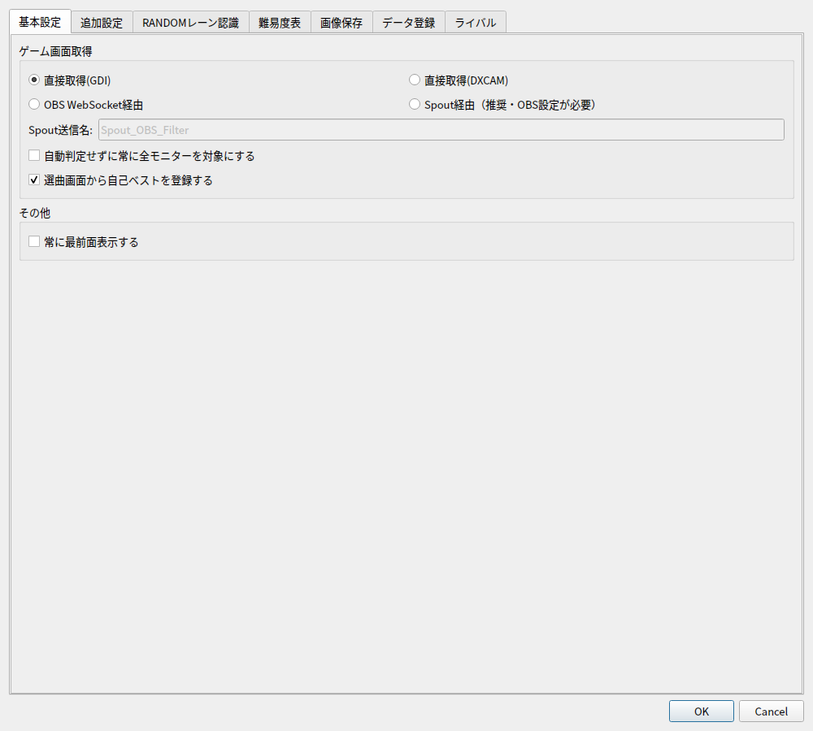
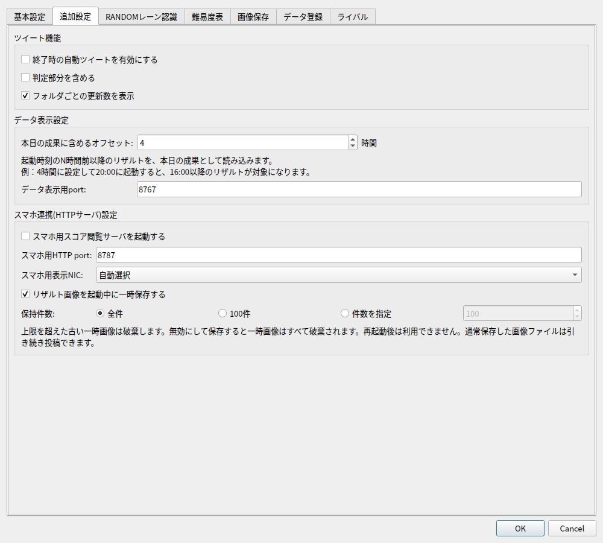
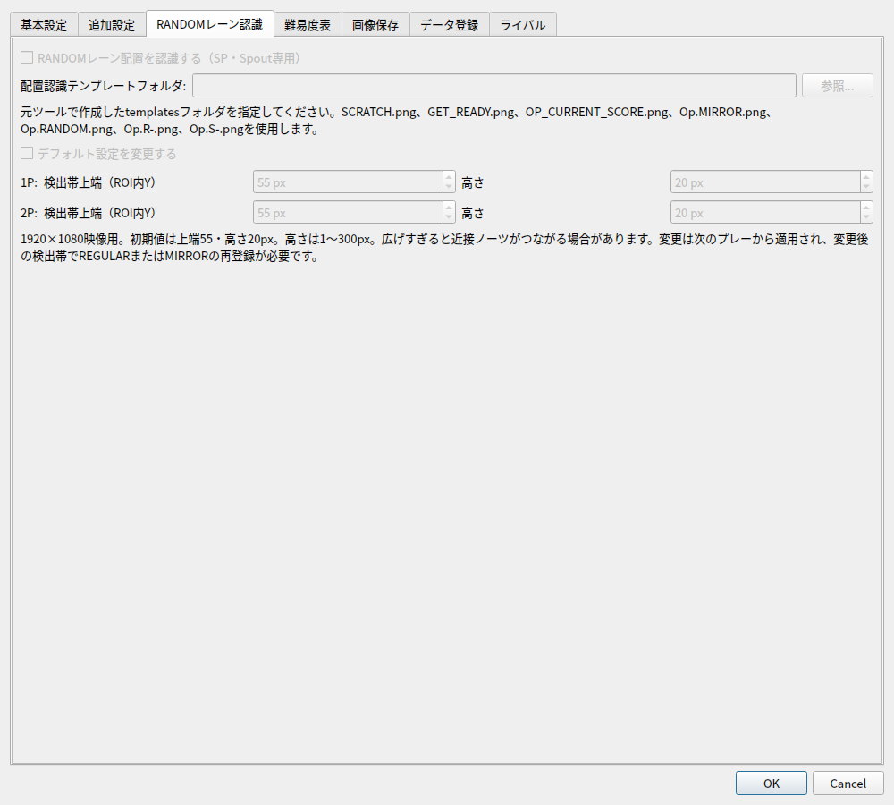
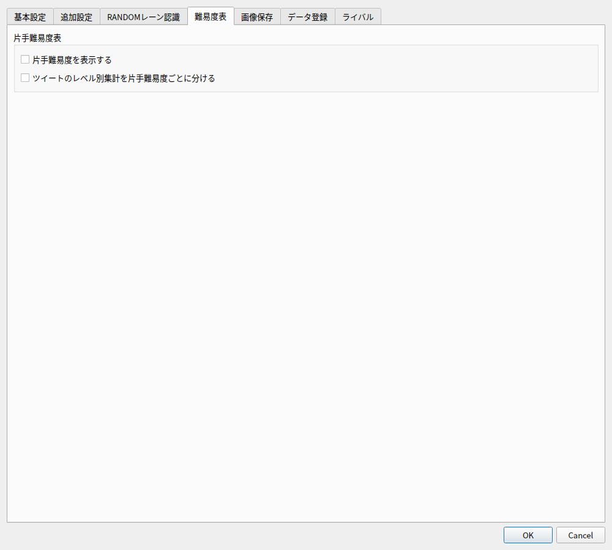
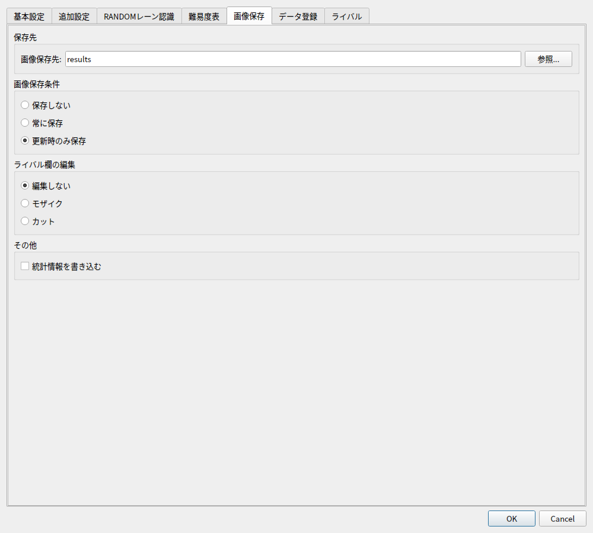
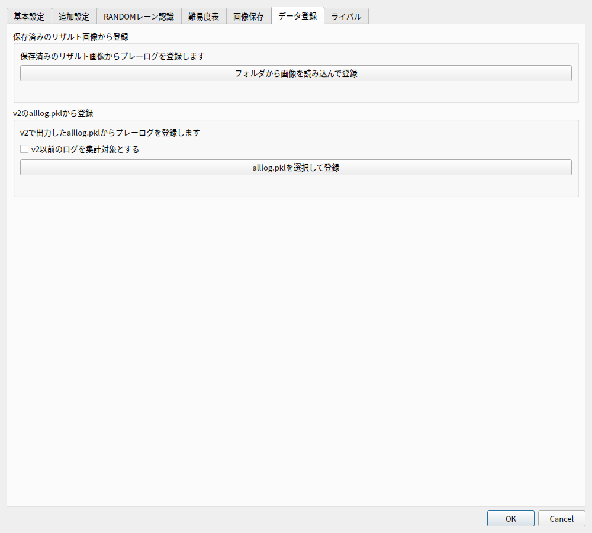
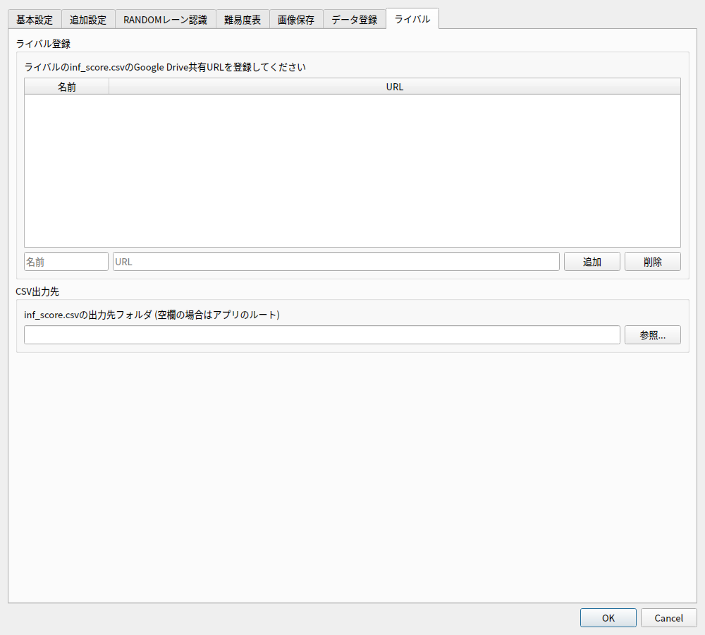

# 設定画面で設定できること

「ファイル」→「基本設定」を開くと、用途ごとに分かれたタブから設定できます。
変更後は「OK」で保存・適用します。「キャンセル」では画面上の変更を保存しません。
以下の初期値は、新規設定で起動した場合の値です。以前の設定を引き継いだ場合は保存済みの値を使います。

| タブ | 主な設定 |
| --- | --- |
| [基本設定](#basic) | ゲーム画面の取得方法、自己ベスト登録、最前面表示 |
| [追加設定](#additional) | 成果の投稿、データ表示、スマホ連携、一時画像 |
| [RANDOMレーン認識](#random-lane) | SPの配置認識、テンプレート、検出帯 |
| [音声案内](#voice-guidance) | VOICEVOXによる起動・終了・レーン配置の案内 |
| [オーバーレイ](#overlay) | ゲーム画面への配置・単曲ログ・本日のプレーログの表示 |
| [難易度表](#difficulty) | 片手難易度の表示と投稿時の集計 |
| [画像保存](#image-save) | 保存先、自動保存条件、ライバル欄の加工 |
| [データ登録](#data-import) | リザルト画像・v2ログの取り込み |
| [ライバル](#rival) | ライバルCSVの共有URL、自分のCSV出力先 |

OBSの接続先・自動制御ルールは、別の「ファイル」→「[OBS制御設定](obs-control.md)」で設定します。

## 基本設定タブ {#basic}

### ゲーム画面取得

| 取得方法 | 使う場面・必要な準備 |
| --- | --- |
| 直接取得(GDI) | 初期値。OBSを使わずゲームウィンドウを読み取ります |
| Spout経由（推奨・OBS設定が必要） | OBSのSpout2プラグインから映像を受け取ります。[導入手順](capture.md#spout)に沿ってフィルタと送信名を設定します |
| 直接取得(DXCAM) | 直接取得の別方式。GDIで取得できない場合などに試します |
| OBS WebSocket経由 | OBSからキャプチャを受け取ります。[接続と監視対象ソース](obs-control.md#monitor-source)の指定が必要です |

「Spout送信名」の初期値は `Spout_OBS_Filter` です。OBS側の表示と一致させてください。
「自動判定せずに常に全モニターを対象にする」はGDI用です。通常はOFFのまま使い、複数モニターで取得できない場合に試します。
取得方法の詳しい手順と切り分けは[ゲーム画面の取得](capture.md)を参照してください。

「選曲画面から自己ベストを登録する」は初期状態でONです。
選曲画面を読み取って自己ベストを追加します。手動登録は **F7** でも行えます。
「常に最前面表示する」は、打鍵カウンタを他のウィンドウより手前に表示する設定です。

## 追加設定タブ {#additional}

### ツイート機能

「終了時の自動ツイートを有効にする」をONにすると、アプリ終了時に成果の投稿画面を開きます。
初期値はOFFです。投稿画面は「ツール」→「成果をツイート」からも開けます。
「判定部分を含める」「フォルダごとの更新数を表示」で、投稿文へ含める集計を選びます。
初期値は判定部分がOFF、フォルダごとの更新数がONです。

### データ表示設定

「本日の成果に含めるオフセット」は、起動時刻の何時間前以降のリザルトを本日の成果へ含めるかを指定します。
初期値は **4時間** です。例えば20:00に起動して4時間を指定した場合、16:00以降のリザルトが対象です。
PCやアプリを起動し直した場合に、その前のプレーも表示したいときに調整します。

「データ表示用port」の初期値は **8767** です。HTMLビューへデータを送るWebSocket用で、
OBS接続用ポートやスマホのHTTPポートとは別です。ほかのアプリと競合する場合に変更します。
変更後は打鍵カウンタとHTMLビューを再起動・再読み込みしてください。
別PCから表示する場合は[HTML側の接続先](obs-views.md#remote-pc)も合わせます。

### スマホ連携(HTTPサーバ)設定

「スマホ用スコア閲覧サーバを起動する」でサーバを有効にします。初期値はOFFです。
「スマホ用HTTP port」は **8787**、「スマホ用表示NIC」は **自動選択** が初期値です。
[スマホで開く手順](mobile.md)に沿って、同じLANの端末からアクセスします。

「リザルト画像を起動中に一時保存する」は初期状態でON、保持件数は **全件** です。
「100件」または「件数を指定」に変えると、古い画像から破棄します。
無効にして保存すると一時画像はすべて破棄されます。ファイルとして通常保存した画像は削除しません。
一時画像は再起動後には使えません。[画像の選択・結合](mobile.md#result-images)も参照してください。

## RANDOMレーン認識タブ {#random-lane}

SP・Spout経由の1920×1080映像用です。初期状態では認識はOFFです。
[RandomLaneAnalysis_OCR](https://github.com/yuki-RAI01/RandomLaneAnalysis_OCR)でテンプレートを作成し、
生成された `templates` フォルダを「配置認識テンプレートフォルダ」に指定します。
正規またはMIRRORで一度譜面を登録してから、同じ譜面をRANDOM・R-RANDOMでプレーします。
いきなりRANDOMでプレーしても、未登録の譜面の配置は確定できません。

検出帯は初期値が1P・2Pともに **上端55・高さ20px** です。
「デフォルト設定を変更する」をONにした場合だけ編集できます。
画面を開くたびに編集がロックされますが、保存済みの値は維持します。
検出帯を変更した場合は、その帯で正規またはMIRRORの再登録が必要です。
必要なテンプレート名や認識条件は[配置認識の説明](features.md#random-lane)を参照してください。

## 音声案内タブ {#voice-guidance}

一番上の「基本設定」セクションに、有効チェック・接続先URL・話者スタイルID・出力デバイス・音量・定位をまとめています。
その下の「案内する項目」セクションで、読み上げる内容を選びます。
「音声案内を有効にする」で切り替えます。全体の初期値は **OFF**、
各案内項目の初期値は **ON** です。全体をOFFにしても各項目の選択は保持されます。
チェックボックス右の「テスト」で、案内メッセージをランダムに1つ読み上げます。
全体や個別項目のON/OFFにかかわらず、画面で入力中の基本設定を使って試せます。
テストでは設定は保存されません。再生中はテストボタンが無効になります。
音量は **0〜100%（初期値100%）**、定位は **-100〜100（初期値0）** です。
定位は-100で左のみ、0で中央、100で右のみです。中央から動かすと反対側の音を小さくします。
定位を変更したモノラル音声はステレオに変換して再生するため、出力先にはステレオ再生対応が必要です。
基本設定は音声案内がOFFでも編集でき、保存後は通常の案内にも反映されます。
VOICEVOXを別途起動して使用してください。日本語の音声を「出力デバイス」で選んだ先に再生します。
初期値は「システムの既定」です。スピーカー・ヘッドホン・仮想音声デバイスなどを個別に選択できます。
デバイスの接続を変更した場合は設定画面を開き直してください。
保存したデバイスが見つからない場合は「保存済みのデバイス（未接続）」と表示し、その選択を保持します。
未接続のデバイスを指定したままでは再生せず、ログに記録します。
OBS配信に載せる場合は、その出力先の音声をOBSでも取り込んでください。

| 項目 | 読み上げ内容 |
| --- | --- |
| 打鍵カウンタ起動時 | 「打鍵カウンタを起動しました」 |
| レーン配置表示関連 | 未登録時に「正規かミラーでプレイしてください」、記録開始時に「正規譜面を取得中」 |
| 譜面情報 | ガチ割れ、逆割れ、2356（にーさんごーろく）、Xバス |
| 自己ベスト時 | 「初イージー」「初ノマゲ」「初ハード」「初エクハ」「初フルコン」「スコア更新」「ミスカウント更新」 |
| リザルト保存時 | 「リザルトを保存しました」 |
| 打鍵カウンタ終了時 | 「打鍵カウンタを終了しました」 |

「自己ベスト時」は初期値 **ON** です。プレー後のリザルトを登録したときに、更新前の自己ベストと比較して案内します。
イージー以上のランプが自己ベストを更新した場合、今回のランプだけを読み上げます
（例：イージーからハードなら「初ハード」）。初プレーでもイージー以上ならランプを案内します。
スコアは初プレーを除き、以前より増えた場合に「スコア更新」、
ミスカウントは以前の記録より減った場合に「ミスカウント更新」と読みます。
比較対象のないミスカウントや途中落ちのミスカウントは案内しません。
複数更新した場合は、ランプ・スコア・ミスカウントの順に全て読み上げます。
選曲画面や過去画像の取り込みでは案内しません。テストボタンの候補にはこれらのメッセージも含まれます。

「リザルト保存時」は初期値 **ON** です。リザルト画面からDBへの登録・保存が成功したときに案内します。
自己ベストを更新していないリザルトも対象です。自己ベストの案内がある場合は、その後に読み上げます。
同じリザルトの再読み取りや、画像保存だけでは案内しません。テストボタンの候補にも含まれます。

譜面情報・レーン配置の案内には、[RANDOMレーン認識](#random-lane)の有効化と設定が必要です。
1357鍵が右端4レーンに集まると1Pではガチ割れ・2Pでは逆割れ、左端4レーンではその逆です。
1357鍵が2・3・5・6レーンにある場合は「にーさんごーろく」と読みます（例：`2716354`）。
Xバスは1鍵の位置です（例：`6175423`は「2バス」）。
部分配置でも条件が確定すれば読み上げ、同じプレー中は同じ情報を繰り返しません。
譜面情報をONにすると、これらの情報をまとめて有効にします。

接続先URLの初期値は `http://127.0.0.1:50021`、話者スタイルIDの初期値は `1` です。
IDはVOICEVOXエンジンの `/speakers` にあるスタイルの `id` を指定します。
APIの詳細は[VOICEVOX ENGINE公式資料](https://github.com/VOICEVOX/voicevox_engine#readme)を参照してください。
保存するとすぐに反映されます。起動時の案内は次回起動から有効です。
接続や再生に失敗した場合はログに記録し、カウンタの処理は継続します。

## オーバーレイタブ {#overlay}

「ゲーム画面へのオーバーレイを有効にする」で、ゲームの上にクリックを透過する最前面ウィンドウを表示します。
機能全体の初期値は **OFF**、各表示項目の初期値は **ON** です。各項目を個別に無効にできます。
全体をOFFにしても項目の選択は保持されます。保存すると再起動なしで反映します。

「ログの表示設定（選曲・リザルト共通）」の「配置が分かる場合はレーン番号で表示する」をONにすると、
単曲ログと本日のプレーログのオプション欄をレーン番号表示に切り替えます。初期値は **OFF** です。
HTMLの `--show-lane-numbers: 1` と同じ表示で、部分配置にも対応し、配置不明の場合はオプション名を表示します。

| 項目 | 表示する画面 | 内容 |
| --- | --- | --- |
| ランダム配置 | プレー画面 | 認識済みの配置・部分配置。RANDOMレーン認識の有効化が必要です |
| 単曲ログ | リザルト画面 | `history_cursong.html` の情報（自己ベスト、BPI情報、プレー履歴など） |
| 本日のプレーログ | 選曲画面 | `today_result.html` の情報（本日のリザルト一覧） |

配置の位置・大きさは、取り込み元のRandomLaneAnalysis_OCRの保存設定に合わせています。
1920×1080基準で1Pは左上 `(160, 532)`、2Pは `(1413, 655)`、倍率はどちらも `0.74` です。
配色は本アプリのHTML表示と同じで、1は赤文字の白鍵、偶数は黄文字の青鍵、その他の奇数は黒文字の白鍵です。
部分配置は数字・色が分かるところを表示し、不明部分は灰色になります。
元ツールのフォルダや設定ファイルは実行時には不要です。

ログは1920×1080基準で、リザルト画面では `(565, 360)` から `780×585`、選曲画面では `(22, 615)` から `564×180` の領域に表示します。
単曲ログは最大20件、本日のプレーログは直近6曲までを表示し、それぞれの領域からはみ出さないよう全体を縮小します。
OBS用のHTMLの表示件数は変更しません。
ゲームウィンドウの位置・サイズに追従し、画面状態が不明なとき、画面取得が停止したとき、ゲームウィンドウが見つからないときは非表示になります。
配置・ログの表示用ウィンドウはWindowsのキャプチャ除外を設定し、画面取得への映り込みを防ぎます。
HTMLへの接続には既存のデータ表示用WebSocketサーバを使います。配布版にはQt WebEngineも同梱する必要があります。
ログ表示にはQt（PySide6）6.10.2以降が必要です。6.10.1には初回表示時にアプリ全体が終了するGPU情報取得の不具合があるため、古いQtではログのオーバーレイを起動しません。
開発・ビルド環境では更新した`uv.lock`の依存バージョンを反映してから再ビルドしてください。Qt DLLだけの差し替えではなく、PySide6・Addons・Essentials・Shibokenを同じ版で更新します。
最前面ウィンドウによる表示のため、ゲームはウィンドウ表示またはボーダーレス表示で使用してください。

## 難易度表タブ {#difficulty}

「片手難易度を表示する」をONにすると、SP☆11・☆12の片手難易度を表示します。
「ツイートのレベル別集計を片手難易度ごとに分ける」で、成果の投稿に使う集計も切り替えられます。
どちらも初期値はOFFです。

## 画像保存タブ {#image-save}

保存先の初期値はアプリのフォルダ内の `results`、自動保存条件は **更新時のみ保存** です。
ライバル欄の編集は **編集しない**、統計情報の書き込みはOFFです。
[リザルト画像の保存](image-save.md)で、自動保存条件・モザイク・カット・統計情報の例を説明しています。
起動中だけ保持する画像の設定は、このタブではなく[追加設定](#additional)にあります。

## データ登録タブ {#data-import}

「フォルダから画像を読み込んで登録」で、保存済みのPNG画像からプレーログを登録できます。
v2・v3のリザルト画像が対象です。選択したフォルダ直下を読み取るため、サブフォルダに分かれている場合はそれぞれ指定します。

v2のデータは「alllog.pklを選択して登録」からも取り込めます。
古いログは曲名などの誤認識が含まれる場合があるため、画像が残っている場合は画像からの取り込みを優先してください。
「v2以前のログを集計対象とする」の初期値はOFFです。過去ログも集計したい場合にONにします。
詳しくは[v2からの移行](migration-v2.md)を参照してください。

登録処理はボタンを押して実行します。実行済みの取り込みは、設定画面の「キャンセル」では元に戻りません。
誤ったプレーログは[スコアビューワ](score-viewer.md)で確認して削除できます。

## ライバルタブ {#rival}

Google Drive上の `inf_score.csv` の共有URLと表示名を登録します。
ここで指定した名前がスコアビューワと `rival.html` に表示されます。
[ライバル登録](rivals.md)の手順で共有範囲も確認してください。

「CSV出力先」では、自分の自己ベストCSVを出力するフォルダを選びます。
アプリ終了時に出力し、空欄ならアプリのフォルダを使います。Google Driveの同期フォルダも指定できます。
ライバル比較を使わない場合に、Google Driveの設定を行う必要はありません。
